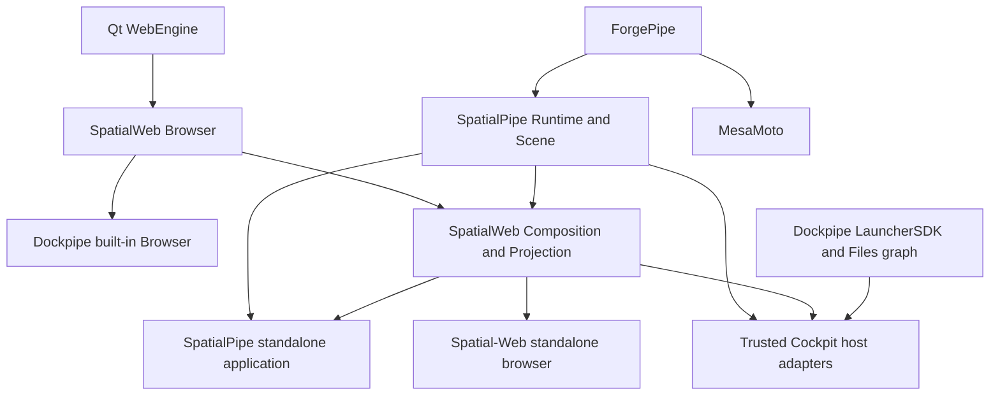

# ForgePipe engine and spatial ecosystem extraction

Status: implementation authorized, in progress. The hosted ownership milestone below records
completed product candidates and the remaining composed-delivery gates. Earlier dated checkpoints
preserve the proposal and evidence available at that time. This is an extraction of existing behavior,
not a new engine rewrite. The complete file inventory is
[migration-inventory.tsv](migration-inventory.tsv). It records source bytes before migration,
local include edges, destination repository, and whether a file can move or must be split.
A destination is an ownership decision, not evidence that migration has completed.

## Product Composition Refinement

The [2026-10-17 product/package boundaries](product-package-boundaries.md) refine the extraction:
SpatialPipe ships custom worlds and spatial web without DockPipe host providers; MesaMoto is an
optional universe experience and standalone game; normal browsing becomes built into the DockPipe
desktop, independent of optional spatial packages. The ordinary browser component must therefore
be separated from the spatial library dependencies shown below. These originated as target
contracts; the hosted ownership milestone below records the subsequently qualified artifacts.

## Ownership and dependency contracts

| Repository | Owns | Must not require |
| --- | --- | --- |
| forgepipe (private) | Rendering, geometry, terrain/soil/water/weather, simulation, generic vehicle physics, camera/input/audio, engine asset and persistence foundations | Any consumer, DockPipe installation |
| MesaMoto (private) | Bike configuration/tuning/assists, rider/race rules, tracks/RedBud, game presentation/content and standalone shell | DockPipe or SpatialPipe application |
| SpatialPipe (private) | Offline worlds/planets, furnishing, generalized screens, portals, persistence; standalone application and separately packaged Cockpit host integration | DockPipe integrations or mandatory network identity in the offline runtime/application |
| Spatial-Web (public) | Interpretation, discovery, manifests, web composition, reusable browser library and separate Spatial Browser shell | Cockpit, privileged host providers, private source access |
| dockpipe | Native host SDK, generic package loading, host settings and installation; consumes optional Cockpit owned by SpatialPipe | Any spatial dependency with Cockpit absent/disabled |

One implementation per capability. CMake installed package targets and versioned binary SDKs
are the native boundary; no consumer source directory imports or sibling `add_subdirectory`.
Same engine backs the future PipeLang bindings. Those bindings are not implemented or claimed
as a working SDK by this migration's initial native checkpoint. PipeLang's current native
compiler contract targets Go; an engine ABI and tested binding path are still required.

## Observed seams and extraction order

1. Extract the closed terrain/material/mesh, native renderer/paint ordering, scenery and flight
   dynamics set. Keep current public C++ type names to preserve callers. Replace resource URLs
   with engine-owned resources. Build/install/test independently, then link Cockpit to that SDK.
2. Split `SpatialVehicle`'s mesh-face contracts and generic dynamics from model/content factories.
   `DirtBikeDynamics.cpp` imports `SpatialWorkspace.h`; its ground query boundary must become an
   engine scene/surface contract. `DirtBikeSteeringRig.cpp` imports game model metadata. Move
   tuning/assists as explicit content configuration without changing defaults or physics steps.
3. Extract offline workspace/furnishing storage with caller-supplied paths. Current stores import
   launcher `ContextStore`; Cockpit adapters must keep its exact paths and wire format. Preserve
   unknown/unavailable screen provider IDs and stored targets. Do not migrate real user files
   during development. Prove fixture load/save, invalid-file preservation and concurrent writes.
4. Split `WorkspaceFlightView` (and related translation units) at rendering, scene navigation,
   filesystem graph, native windows, bike gameplay and HUD boundaries. It currently inherits
   launcher `CanvasView` indirectly through `WorkspaceGraphView`. Moving it whole would make the
   engine depend on launcher, game and spatial libraries and introduce dependency cycles.
5. Extract browser model/discovery and then its view through the shared scene interface.
   `SpatialWebBrowser` directly constructs the combined view and exposes bike/headquarters
   shortcuts. Move headquarters actions to the appropriate host; remove MesaMoto integration from
   Spatial-Web and ordinary browsing. MesaMoto entry belongs only to its standalone shell or the
   optional SpatialPipe Games World package. Keep browser fallback and the existing URL policy.
6. Build standalone shells using the same libraries and compare gameplay/persistence/browser
   behavior. Only retire original source after equivalent consumers pass.

`ScreenProviders.cpp` currently performs local file preview and app selection. The shared
runtime must own provider contracts/placement, while host access stays in explicitly registered
trusted adapters. Public web content cannot acquire local capabilities by naming a provider.

## Package and release contract

DockPipe's existing `depends` and `requires_resolvers` fields resolve names within one catalog;
they are not semantic version range expressions. Do not invent versioned dependency YAML.
Use exact CMake package versions plus a release lock of immutable artifact digest, engine
version, ABI/platform, Qt version and provenance. Catalog publication must select a compatible
closure. The ordinary Cockpit package remains the activation/installation boundary.

The first native package is `ForgePipe 0.1.0`, imported target `ForgePipe::Engine`, with public
headers under `include/forgepipe`, a shared library, resources and notices. This initial SDK
uses Qt C++ types: compiler, architecture, build configuration and Qt ABI must match. It is not
a stable C ABI or a portable binary across arbitrary toolchains. Unsupported versions must fail
configuration; applications must bundle the matching runtime for standalone distribution.

Existing DockPipe `.github/workflows/ci.yml`, `release.yml`, `flatpak.yml` and
`homebrew-staging.yml` own repository gates and channel publication. Release builds allocate
versions and use the existing checksums/catalog/provenance path. ForgePipe artifacts must enter
that controlled staging/production path through an explicit immutable lock. The user authorized
GitHub publication on October 16 through `js/dev -> dev -> staging -> master`, with
standalone packages qualifying first and DockPipe staging consuming their pinned versions.
Production promotion requires successful qualification. Rollback selects the prior tested lock/catalog and
runtime without rewriting user data. Paid games ship through their own installers/Steam later,
not the DockPipe package store. Each repository needs CI. Preserve unrelated checkout work
when checkpointing and publishing this scope. Local pipeline files alone are not hosted CI proof.

## Provenance and distribution limits

The starting repository is Apache-2.0, including `cockpit/package.yml`. The current Cockpit
files are untracked user work; tracked predecessor scene files are attributable to DockPipe
commit `c604b291d463906acf0a05ef8cfe2efc071bdbaa`. Inventory hashes preserve the actual
uncommitted postimages, which that commit does not describe. Retain the Apache license and
source notices with extracted code. Private repository visibility does not retract previously
granted public rights. This record does not grant new proprietary rights or relicense code.

Owner intent: keep engine source private while permitting engine SDK/runtime use and
redistribution with the public Spatial Browser and Cockpit, including community worlds and
browser modifications. Final redistribution terms, attribution and inherited third-party
obligations require review before public binary delivery. No credentials or private source may
be included in public build inputs. Public contributors need a redistributable SDK/runtime
without private-repository authentication; until that artifact and terms exist, full public
application build readiness remains blocked. Pure public model/schema tests must work without it.

Existing material provenance is retained from [SpatialPipe material provenance](https://github.com/Dockpipe-Industries/SpatialPipe/blob/dev/packages/cockpit/resources/materials/README.md);
furniture includes Kenney CC0 notices, bike content its own Innerscene provenance. Qt module
licenses, LGPL/commercial conditions and WebEngine/Chromium third-party notices require an
artifact-specific distribution review. The Qt resolver commercial product is excluded.

## Acceptance evidence

The admitted baseline includes the existing terrain, wheelie/race, rival, RedBud and return-portal
validation documents in [SpatialPipe Cockpit docs](https://github.com/Dockpipe-Industries/SpatialPipe/blob/dev/packages/cockpit/docs). RedBud is an approximate map study, not a
surveyed replica. Native/offscreen evidence is distinct from interactive gameplay qualification.
Keep the existing running preview untouched.

At the initial extraction checkpoint, the terminal gates were installed SDK consumers, standalone MesaMoto/SpatialPipe/Browser,
optional Cockpit integration, real packaged installation/upgrade/rollback, saved-world and
provider preservation, public build path, per-repository CI/release artifacts and cross-repository
integration. Inventory or individual compilation alone does not complete this objective.

### Verified first extraction checkpoint

ForgePipe 0.1.0 now builds independently and installs a relocatable CMake SDK. Its
terrain and flight tests pass; the existing renderer regression passes on the host GPU.
An external consumer of the unpacked archive verifies terrain deformation, flight and
embedded materials. It requires the matching Qt runtime in the loader search path;
the first run correctly exposed an accidental system-Qt mixture. Standalone bundles
must carry that matching runtime rather than depend on the host Qt version.

Cockpit now uses `find_package(ForgePipe 0.1.0 EXACT)` and `ForgePipe::Engine`.
Its eight affected tests pass: site-world, furnishing, flight-dynamics, return-portals,
spatial-terrain, dirt-bike, spatial-vehicles and spatial-workspace. The first workspace
run used a stale executable and crashed; rebuilding that target resolved it. Original
engine source/assets were retired only after this proof and a source-hash check.
Existing world files and the running preview were not changed. Engine extraction is
partial; this does not qualify a complete standalone game, spatial runtime or browser.

### Added user-authorized scope

The native SDK hardening specification now applies to ForgePipe and Nucleon together:
minimal ABI, runtime/SDK/private-debug separation, publisher authentication, package
integrity, licensing segregation and measured performance. Preserve the existing
Nucleon native/PipeLang integrations and make Nucleon an optional ForgePipe compression
adapter. In-house use and public redistribution need explicit separate release policy;
license terms still require owner/counsel approval before external release.

DorkPipe package, MCP and editor sources now belong to the public
[DorkPipe repository](https://github.com/Dockpipe-Industries/dorkpipe). The former private
repository is preserved as `dorkpipe-platform`, retaining platform-specific code,
private history and frozen releases. Pipeon remains in its private repository. Preserve
package identities, user state and independent pipelines feeding the DockPipe catalog.
The engine's own repository remains independent of these package implementations.

### Product naming and package visibility

ForgePipe names the native engine. The former "ForgePipe Game Studios" label is
retired. AI product features belong to the optional, independently versioned DorkPipe
package and enhance the existing DockPipe application, CLI and unified MCP endpoint.
[TASK-008](https://github.com/Dockpipe-Industries/dorkpipe/blob/master/docs/agents/tasks/agentic-app-ui/overview.md) records the unbuilt AI authoring
and inspection scope; it does not define a separate DockPipe AI package or application.
Ordinary local use must not require a separate AI container stack, persistent daemon
or managed database. Optional isolated workers and remote execution use DockPipe lifecycle
and permission contracts. DockPipe core owns generic extension mechanisms and remains
usable without DorkPipe; ForgePipe remains the game/spatial engine.

Delivery priority is shared core networking and package/version foundations, then
unified MCP integration, then DorkPipe graph/knowledge/context features. A later optional Models area may be contributed as top-level DockPipe
navigation by DorkPipe. Users choose supported local, remote or hosted execution
providers through package-owned adapters and DockPipe runtime contracts. Model
management, chat and richer AI authoring must not gate the initial MCP/knowledge
slices; indexing, full-text search and explicit graph operations work without inference.
No new model runtime or mandatory container stack is implied by the Models area.

Pipeon development is paused. Its six installable workflow/resolver manifests use
`hidden: true`; normal catalog/Marketplace discovery omits them after the updated
catalog is built and published. Explicit installs, dependency resolution and existing
installations remain supported. DorkPipe owns both editor-extension source trees;
Pipeon consumes versioned VSIX artifacts rather than compiling editor sources.

### Package and editor checkpoint

The generic package contract now carries `hidden` through compiled metadata and
catalog JSON. CLI catalog discovery filters it unless `--include-hidden` is set.
Tests cover directory/tarball metadata, legacy defaults, empty discovery arrays,
explicit hidden installs and hidden dependencies. Installed inventory remains intact.
Pipeon's two resolvers and four workflows are marked hidden in both source checkouts.

The two editor trees (32 original authored files) were extracted into DorkPipe,
with independent candidate CI and VSIX builds. Twenty original implementation or
authoring files were retired after hash checks; Pipeon retains its packaging recipe,
settings, artwork, notices and generated-file ignore rules. Candidate VSIX packaging,
language tests, TypeScript compilation, webview smoke checks, relocated runtime
contract assertions, real artifact import and digest-tamper rejection passed locally.
Pipeon's six existing shell suites pass using isolated test state. Public DorkPipe
0.6.5 staging qualification and package-host publication pass at source
`cc31cf0aa8481479df4d54142003ca0b6546d677`, including both editors and the two
migrated documentation workflows. All 59 package-host objects match the frozen
release. Pipeon 0.6.6 maintenance publication and all eighteen package-feed object
readbacks pass, using the exact DorkPipe 0.6.5 resolver and editor inputs. The six
owned Pipeon packages remain hidden and feature development remains paused.

DorkPipe/MCP and Pipeon sources are extracted into their owning repositories, but
their original package trees remain pending final composed-store qualification.
This is not yet a completed removal of those packages
from Dockpipe's source bundle. The generated embed manifest was refreshed to match
the current authored source, including the existing Cockpit package migration.

Final local recheck: the CLI, Cockpit launcher and SDK consumer targets build.
Seven affected Cockpit suites passed after source retirement; the bike suite exposed
four test assertions still using the old material resource prefix. Updating those
assertions to ForgePipe's resource ownership and rebuilding made the bike suite pass.
No live preview was restarted. The broad Go sweep remains unqualified because
generated PipeLang tests require their contained runner; the affected package suites
pass. The unrelated APT signing fixture could not start its GPG agent in the sandbox;
the focused embedded-input regression passes.

### Repository execution checkpoint

Root AI guidance, initialization, workflow entrypoints, CI bootstrap and the local Go
compatibility SDK are recorded in [repository-workflows.md](repository-workflows.md).
At this repository-setup checkpoint, the three unextracted products had scaffold-only checks;
independent application and package-feed qualification were still open. The current hosted
ownership milestone below supersedes that implementation status. ForgePipe's private staging release has passed
GitHub gates. Nucleon's tested SDK packages and matching debug archive are durably
published privately; public registry delivery and license approval remain open.
DorkPipe 0.6.5 is published from its public source and verified on the staging
package host using compiler 0.6.17. Pipeon 0.6.6 is also published and verified.
The frozen pair passes local Linux composition and all 69 KDE 6.10 Flatpak
dependency/preflight profiles, including final store export. Main source retirement
and hosted staging qualification remain pending; no production release is implied.

### Protected staging delivery (2026-10-19)

The user approved releasing the ForgePipe SDK and integrating Cockpit into the
current Dockpipe staging candidate. This approval covers the audited native SDK
artifact; it does not publish the private engine repository or alter inherited
Apache-2.0, material or Qt license obligations.

The native SDK now restricts dynamic definitions to 32 reviewed API symbols.
Optimized Release builds produce matching private diagnostics before stripping;
public SDKs exclude debug sections, static symbol tables, implementation source
and unapproved headers. The publisher checks a fixed 20-file SDK inventory and
attests both the immutable archive and source-bound metadata. Cockpit verifies
those attestations and exact size/digest/source/Qt pins before extraction.
Matching diagnostic build IDs and hashes were read back from durable private
storage before public delivery. The SDK comes from source
`49cbfc7dbc37e65854464666245fadbf06732012` and is published as
[forgepipe-sdk-0.1.0-staging.49cbfc7dbc37](https://github.com/Dockpipe-Industries/dockpipe/releases/tag/forgepipe-sdk-0.1.0-staging.49cbfc7dbc37).
Its private diagnostics remain in the private ForgePipe release. Stripping and
restricted exports reduce disclosure; they do not make native binaries impossible
to reverse engineer.

Native Linux amd64 packaging uses Qt 6.10.3 on the Ubuntu 22.04 ABI baseline.
Cockpit 0.1.1 is composed into the optional resolver catalog only after its native
and packaged rendering checks; unrelated pinned store entries remain unchanged.
ARM64 retains its existing distribution Qt lane and does not establish native
ForgePipe/Cockpit compatibility. Cockpit is qualified here only for native Linux
amd64, not ARM64, macOS, Windows or Flatpak.

The complete Dockpipe staging release is
[`0.6.20-staging.39285769512.1.0399bb37bb7d`](https://github.com/Dockpipe-Industries/dockpipe/releases/tag/v0.6.20-staging.39285769512.1.0399bb37bb7d),
from source `0399bb37bb7d795ca55fc240bcfa4928fe3f1c14`. All six desktop/CLI
release lanes passed. Public downloads, immutable catalogs, GitHub asset digests,
signed APT packages and both native Homebrew installations were read back against
that candidate. The rebuilt [staging site](https://staging.dockpipe.com/) serves
the same product source, catalog and Cockpit digest; all 12 public documentation
routes passed HTTP readback. A fresh published CLI installed Cockpit 0.1.1 from
the native Linux amd64 catalog into an isolated store; its archive matched the
published digest.
All 47 runtime ELF files passed the private-symbol/debug-section audit, and the
engine matched the 32 reviewed exports and retained diagnostic build ID.

The dashboard layout optimization passed the original 100 ms transition limit on
both Mac architectures; no platform exception was added. Native Linux rendering
qualification used the CI compositor and does not establish physical GPU gameplay
acceptance. This delivery does not complete standalone product extraction,
PipeLang bindings or a stable cross-toolchain SDK ABI. Production was not promoted.

### Independent SpatialPipe and Cockpit delivery continuation (2026-10-20)

SpatialPipe owns the offline scene/runtime and the separate optional
`packages/cockpit` implementation, assets and feature tests. The root runtime
exports `SpatialPipe::Runtime`; it does not build Cockpit or import Dockpipe host
adapters. Cockpit consumes installed runtime and host SDKs. Its ContextStore
adapter supplies the existing paths; version-1 persistence and saved user data
remain unchanged. The three original dirty WorkspaceGraph source/test files are
preserved byte for byte in the extracted initial source. The original migration
inventory remains historical evidence, not a current source ownership override.

The dependency candidates are published:

- [DockPipeLauncherSDK 1.0.0](https://github.com/Dockpipe-Industries/dockpipe/releases/tag/launcher-sdk-1.0.0-staging.517747a588eeedf000819d952eb18aa8d8bcc02d),
  source `517747a588eeedf000819d952eb18aa8d8bcc02d`. Its public publisher
  attestation, archive/metadata pins and freshly installed inventory were verified.
- [SpatialPipe SDK 0.1.0](https://github.com/Dockpipe-Industries/SpatialPipe/releases/tag/spatialpipe-sdk-0.1.0-staging.8b67f00a059a440665cdca93069a287fd817ad7f.39387510298.1),
  source `8b67f00a059a440665cdca93069a287fd817ad7f`. The immutable private
  candidate passed hosted publication and fresh authenticated archive, metadata
  and installed-inventory readback.

Both SDKs use Qt 6.10.3 and record their compiler/platform ABI. Cockpit 0.1.2
records its own source and qualification run separately from dependency source
commits. Cockpit publication and the published-package native consumer have now
passed independently, as recorded below; final Dockpipe staging remains pending.

Public Dockpipe consumption selects only the unchanged runtime mirror of the
independent Cockpit candidate. `workflows/qualify/cockpit/assets/cockpit.lock.json` pins the resolver
archive, original qualification receipt and original candidate metadata by exact
SHA-256 and byte size, with an immutable public release/tag and its qualified
LauncherSDK source target. The candidate binds the original SpatialPipe source,
run, compiler, SDK lock snapshots and runtime allowlist. The mirror contains only
the resolver archive, its checksum, store manifest, qualification receipt,
candidate metadata and SHA256SUMS. Private diagnostic archives remain separate;
public consumers neither fetch private diagnostics nor require private source.
An older Cockpit 0.1.1 archive cannot substitute for this extracted candidate.

Before original source retirement, the real published independent package must
pass Dockpipe's local/native installed-assets loader/render consumer and the
original source/archive preservation hashes must be rechecked. The host fixture
loads the module after creating its window and requires X11 rendering without a
skip pass. The source-absent change includes the binary consumer integration and
canonically regenerated embed declaration. Normal PR/checks and final Dockpipe
staging then qualify that resulting tree; no separate staging release is required
before removal. Catalog composition replaces only `resolver/cockpit`, retaining
unrelated entries and archive bytes. The headless engine remains unchanged.

The rendering contract separates actual product throughput from injected
compositor liveness. The unchanged minimum of 40 paint intervals over the fixed
1,500 ms movement sample applies to the viewport selected by the product: raster
fallback on software Mesa, hardware OpenGL on a hardware renderer. The host stays
1440 × 900. Only after that performance gate passes does software Mesa receive
the late-loaded test OpenGL viewport. Its separate fixed-duration functional
phase requires a valid context, multiple paint intervals and completed
`frameSwapped` signals, zero compositor errors, and another completed frame after
hide/show. This synthetic software-GL phase is not a product frame-rate claim or
an exception to the product throughput threshold. Phase-labeled metrics retain
both observations; a final software-GL capture depicts the injected compositor,
not the earlier product raster viewport. The host-owned consumer fixture must
preserve the same distinction. Software-OpenGL liveness and product raster
throughput evidence do not establish physical GPU gameplay or interactive desktop
acceptance.

Published Cockpit and fresh public-consumer evidence:

- [Cockpit 0.1.2 candidate](https://github.com/Dockpipe-Industries/SpatialPipe/releases/tag/cockpit-0.1.2-staging.25ada5f9dc26.run39398537573.1)
  is published from `25ada5f9dc26c9612fb150c8752478a73aa1917a`, qualifying run
  [`39398537573`](https://github.com/Dockpipe-Industries/SpatialPipe/actions/runs/39398537573),
  attempt 1. It uses the exact published SDK pins above.
- The [public runtime mirror](https://github.com/Dockpipe-Industries/dockpipe/releases/tag/cockpit-0.1.2-staging.25ada5f9dc26.run39398537573.1)
  uses the same immutable tag and preserves the six runtime files unchanged.
  `workflows/qualify/cockpit/assets/cockpit.lock.json` records the exact archive, qualification receipt and
  candidate metadata identities. The resolver archive is 192,474,671 bytes with
  SHA-256 `a09bc121f4aceca775e7fc293a02aa3c35efeefe476252ab19b4a80925da22eb`.
  Private diagnostics were not included in the public consumer.
- A fresh host configure/build and required `cockpit-package-rendering` test
  passed against those public bytes with Qt 6.10.3 and llvmpipe. The unchanged
  product raster gate recorded 92 paint intervals in the 1,500 ms sample,
  p95 17.32 ms and maximum 17.40 ms, with zero compositor errors. The separate
  synthetic software-GL phase completed 93 frame swaps and one further completion
  after hide/show, also with zero compositor errors. Its retained capture was
  inspected and is explicitly synthetic compositor evidence, not physical GPU or
  gameplay proof. The fixture used fresh isolated XDG paths and no saved user data.

The published-package native prerequisite is satisfied. The isolated Dockpipe
consumer workspace has now retired all 359 tracked original Cockpit files after
rechecking all 363 original file preimages and the retained archive. The primary
Dockpipe checkout still retains its original source and saved work. The integration
patch applied without fuzz, and canonical embed regeneration and its membership
check passed, removing exactly 359 original source entries. The source-absent CLI
build passed offline using cached Go 1.26.9 with build parallelism limited to two.
All 31 focused tests and the public-content/diff checks passed. These are bounded
local checks; hosted development-PR checks and final Dockpipe staging remain
pending on the source-absent consumer tree, including the actual release identity
and catalog/install readback. The earlier Cockpit 0.1.1 staging release remains historical
evidence and does not satisfy that final source-absent gate.

Current authority covers package candidates and Dockpipe staging only. Production
promotion and Freeflight changes are excluded; PipeLang stays in Dockpipe.
Saved work, saved worlds and the running preview remain preserved. This historical SDK
checkpoint did not establish standalone products, physical GPU gameplay or complete browser/game
extraction. Subsequent product qualification is recorded below; its platform and GPU limits remain explicit.

## Ecosystem ownership cutover checkpoint — 2026-10-20

The current isolated consumer has installed-library boundaries for the remaining native
products. `SpatialWeb::Browser` owns ordinary browsing and requires Qt only;
`SpatialWeb::Composition` owns document, discovery and media composition;
`SpatialWeb::Projection` owns world planning, projected browser UI and neutral scene
composition. The separate Browser-only producer does not require Scene or ForgePipe.
Projection is an optional Linux SDK lane pinned to the qualified native Scene/Forge ABI.
Both standalone browser modes reuse these libraries. Headquarters branding and trusted
host actions remain Cockpit adapters. Neither ordinary nor spatial browsing imports MesaMoto.

`SpatialPipe::Geometry` and `SpatialPipe::Scene`, installed by `SpatialPipeScene 0.1.0`,
own neutral furnishing/room geometry and `SpatialWorldView`. Cockpit supplies host images,
provider admission and explicit actions to that view; its filesystem flight, Git review,
operations and desktop-window controls remain host features. The standalone universe omits
those providers. Runtime storage still receives explicit paths, and host adapters retain
existing saved-data paths. No real user data was migrated by this cutover.

The Files graph now belongs to the Dockpipe launcher, with its own bounded
`dockpipe-workspace-reader`. It opens directly without acquiring or enabling Cockpit.
Its 2D/orthographic 3D views, camera controls and animated drone remain; graph flight and
its editor overlay were removed from this host feature. The optional package retains a
thin compatibility file-surface adapter. Page limits, workspace containment, link/Git
metadata refusal, cancellation and stale-page checks remain in the host reader.

Preserved preimages and hash manifests precede source retirement in the isolated consumer
and extracted Cockpit package. Reusable Browser, Web composition/projection, Graph and
neutral Scene implementations and their model/media assets have owning library targets;
remaining forwarding headers preserve callers without compiling second implementations.
MesaMoto owns game code/content and its importer; neutral furniture import tooling belongs
to SpatialPipe Scene. Company branding, native app providers and local voice remain host-owned.

Local checks pass installed-library build/link, Browser lifecycle/download regressions,
Graph offscreen and actual X11 rendering, Web/civic/site/input/furnishing/folder-navigation
fixtures, saved-world fixtures, matching-CLI Git review and retained native app handoff.
The original renderer test passes for both preserved and extracted binaries using the CI
private-X11 software driver. Both binaries reproduce the same NVIDIA independent-context
pixel failure on this machine; that negative evidence remains recorded and the assertions
remain enabled. Actual X11 Graph and native handoff rendered on NVIDIA, which does not
establish that every native GPU or game acceptance gate passed.

The retired combined Graph megafixture was archived. Folder travel, paging and reticle
assertions moved to a narrow Cockpit fixture; relevant Graph/security checks belong to
launcher tests. The removed Files flight/editor-overlay branches, legacy large-tree
benchmarks, standalone preview timing and some combined pixel/composition branches were
not all requalified. Their preservation record distinguishes archived coverage from passing
replacement checks.

Source/producer implementation and local proof are not final composed delivery. The hosted
milestone below records subsequently qualified SDKs and product candidates. The exact Cockpit
pin, Marketplace/Settings lifecycle and source-absent Dockpipe staging have separate gates.
Cross-platform Browser qualification is tied to its accepted hosted artifacts and exact Qt/platform
profiles; it does not follow from a Linux run. No production promotion is implied.

## Hosted ownership milestone — 2026-10-20

The following advances the extraction and ownership gates without declaring TASK-037 complete:

- **MesaMoto:** the standalone game and shared game runtime passed hosted checks, normal dev and
  staging promotion, private candidate readback and fresh installed relocation/save/quit lifecycle.
  Staging source is `36307344ff40447f12c177e7f4a8b0545e990f44`, qualifying run
  [`39461501753`](https://github.com/Dockpipe-Industries/MesaMoto/actions/runs/39461501753).
  Hosted metadata states raster qualification and no physical GPU verification. The separate local
  RTX 3080 game evidence does not turn the hosted lane into a physical GPU lane. This is private
  candidate delivery, not public or paid game distribution.
- **Spatial-Web:** five native ordinary-Browser SDK profiles passed hosted qualification and
  artifact readback: Linux amd64/arm64, macOS amd64/arm64 and Windows amd64. The KDE Flatpak
  Browser profile is a separate exact runtime/Qt profile with its own qualification; native SDK
  success is not Flatpak compatibility proof. The Web owning repository's staging promotion and
  artifacts are verified. Projection remains a separate pinned Scene/Forge consumer; matching
  Browser/Projection ownership does not introduce game or privileged host dependencies.
- **SpatialPipe:** the independent app's shutdown repair passed all required checks and merged
  through [PR 8](https://github.com/Dockpipe-Industries/SpatialPipe/pull/8) to dev source
  `abc9fde23b71dfb245f356419e0e3a83aeaeac8f`. Private candidate run
  [`39463448605`](https://github.com/Dockpipe-Industries/SpatialPipe/actions/runs/39463448605)
  passed. All four release assets and 269 runtime files were read back; fresh relocated scene and
  WebEngine/helper smoke passed with isolated state and no game launch or universe write. Physical
  GPU verification is explicitly false in that candidate. The final Cockpit **0.1.3** extraction
  passed [PR 9](https://github.com/Dockpipe-Industries/SpatialPipe/pull/9) and accepted-source run
  [`39474547346`](https://github.com/Dockpipe-Industries/SpatialPipe/actions/runs/39474547346).
  Dev source `d5716567d213b25c85231d6943e3c449558aee63` and staging source
  `5ec39cf123c41af2960062c35009f24bab37202f` have the same qualified tree.
  The public runtime-only mirror is
  [`cockpit-0.1.3-staging.d5716567d213.run39474547346.1`](https://github.com/Dockpipe-Industries/dockpipe/releases/tag/cockpit-0.1.3-staging.d5716567d213.run39474547346.1).
  Its six assets passed digest/readback checks; the archive audit found 116 runtime files,
  including 26 native binaries, without implementation source or private symbol sections.
  Diagnostics remain associated with the candidate in the private owning repository.
- **Dockpipe:** [PR 191](https://github.com/Dockpipe-Industries/dockpipe/pull/191) passed all eleven
  checks and merged into dev at `c740d9dcefcdf04c558b93359c232a1938a01f80`. The published LauncherSDK
  **1.1.0** has been verified. The launcher owns ordinary Browser and the Files graph/reader;
  Cockpit remains an optional installed consumer of the exact host and shared-library SDK pins.

`workflows/qualify/cockpit/assets/cockpit.lock.json` pins that qualified 0.1.3 mirror and its LauncherSDK source exactly.
Flatpak catalog assembly includes the pinned Cockpit store before adaptation. Its mandatory
Marketplace fixture exercises HTTPS discovery, Settings enable/install, normal CLI asset
resolution, installed rendering, Settings disable and CLI removal while preserving fixture
saves and unrelated settings. It does not use a development package override. These checks and
the native consumer checks must pass before promotion. The final staging candidate also requires
catalog/artifact readback and fresh install/update/removal/rollback proof against its exact source.
CLI archive lifecycle and checksum-pinned rollback are distinct from Settings-managed activation.

TASK-037 remains **executing** for its deferred language bindings, stable
ABI and broader GPU/platform acceptance limits. Existing archived-but-unported assertions and the
preserved legacy NVIDIA pixel failure above remain limitations. Native Qt C++ SDKs are not a stable
cross-toolchain ABI. Production and paid distribution are outside this continuation; no real user
worlds, saves or primary-checkout work were migrated or deleted by these verification fixtures.

## Final ecosystem staging delivery

The bounded ecosystem staging continuation is delivered as
[`0.6.24-staging.39534730503.1.9bdf36d2f28d`](https://github.com/Dockpipe-Industries/dockpipe/releases/tag/v0.6.24-staging.39534730503.1.9bdf36d2f28d),
from staging source `9bdf36d2f28d6eddd62e6f01897f5b4a9348cdc3`.
[Run 39534730503](https://github.com/Dockpipe-Industries/dockpipe/actions/runs/39534730503)
passed Linux and Windows CI, Cockpit host qualification, all four Unix release targets,
Windows MSI, Flatpak, artifact assembly and staging publication. Production publication was
skipped. [PR 198](https://github.com/Dockpipe-Industries/dockpipe/pull/198),
[PR 200](https://github.com/Dockpipe-Industries/dockpipe/pull/200) and
[PR 199](https://github.com/Dockpipe-Industries/dockpipe/pull/199) merged normally after
all actual and required checks passed. The released Linux CLI reports Go **1.26.10**,
including the crypto/x509 security fix that blocked the earlier Go 1.26.9 build.

The Windows release embedding test actually passed; its full suite had 49 passes and four
existing skips. Each Mac release suite had 56 passes and four skips, with DMG creation and
native installation smoke passing. Pre-promotion jobs on the identical tree separately created
and checksum-verified disposable DMG fixtures on both Mac architectures and passed 25/25 native
checks per Mac. Intel dashboard p95 was 48.848/46.806 ms
under the unchanged 100 ms gate. These are hosted platform checks, with the GPU limits above.

Independent published-byte verification bound the successful run, committed Cockpit lock,
immutable catalog, package archives and staging latest pointer. The released Linux CLI used
fresh isolated stores to install Cockpit 0.1.2, add 0.1.3, remove each exact archive and roll
back to the checksum-pinned 0.1.2 archive. Fixture saves survived every phase; this archive
lifecycle proof does not claim Settings activation or real user-data migration.
The final hosted Flatpak Marketplace lifecycle/rendering gate passed. Downloaded Flatpak
Cockpit bytes matched their catalog and qualification sidecar; all 116 payload files matched
the native package except the allowed `package.yml` platform adaptation. No whole Flatpak
desktop bundle was installed again during that independent readback. The Flatpak store
manifest is not listed in root `SHA256SUMS`; its identity, package sidecar, archive digest and
native payload equivalence were checked separately.

The final preservation audit rechecked 894 recorded authored-source preimages, retained
retirement archives and the primary checkout's HEAD/full status. Byte preimages were not
available for every other dirty primary file, and actual user saves were not read. All four
production main/master refs matched their pre-publication baselines. One intermediate Windows
fixture READY timeout remains recorded: final runs passed without increasing its deadline;
timings locate cold cost before Qt window display, but the exact constructor remains unidentified.
This closes the bounded staging delivery, while TASK-037 remains executing for deferred
bindings, stable ABI and broader GPU/platform acceptance. The earlier archived-coverage and
NVIDIA limitations remain in force; package and engine ownership boundaries are preserved.
