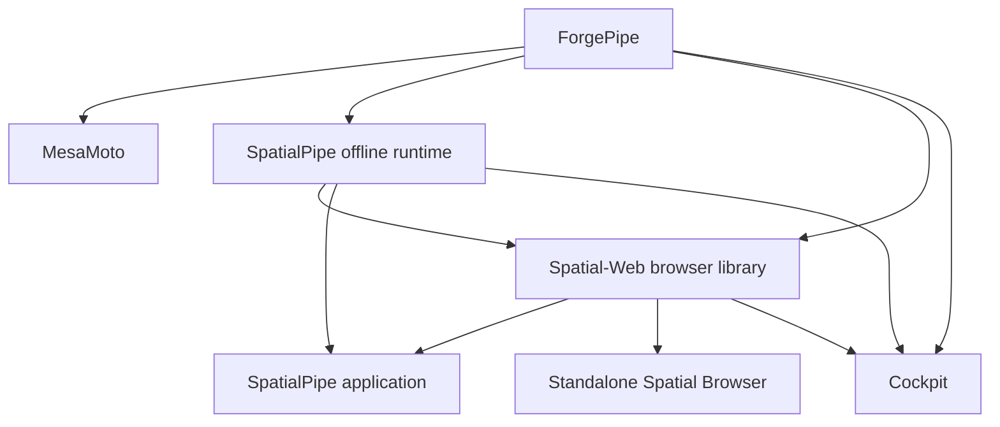

# ForgePipe engine and spatial ecosystem extraction

Status: implementation authorized, in progress. This is an extraction of existing behavior,
not a new engine rewrite. The complete file inventory is
[migration-inventory.tsv](migration-inventory.tsv). It records source bytes before migration,
local include edges, destination repository, and whether a file can move or must be split.
A destination is an ownership decision, not evidence that migration has completed.

## Product Composition Refinement

The [2026-10-17 product/package boundaries](product-package-boundaries.md) refine the extraction:
SpatialPipe ships custom worlds and spatial web without DockPipe host providers; MesaMoto is an
optional universe experience and standalone game; normal browsing becomes built into the DockPipe
desktop, independent of optional spatial packages. The ordinary browser component must therefore
be separated from the spatial library dependencies shown below. These are target contracts, not
claims of shipped extraction or package publication.

## Ownership and dependency contracts

| Repository | Owns | Must not require |
| --- | --- | --- |
| forgepipe (private) | Rendering, geometry, terrain/soil/water/weather, simulation, generic vehicle physics, camera/input/audio, engine asset and persistence foundations | Any consumer, DockPipe installation |
| MesaMoto (private) | Bike configuration/tuning/assists, rider/race rules, tracks/RedBud, game presentation/content and standalone shell | DockPipe or SpatialPipe application |
| SpatialPipe (private) | Offline worlds/planets, furnishing, generalized screens, portals, persistence; separate consumer application | DockPipe integrations or mandatory network identity |
| Spatial-Web (public) | Interpretation, discovery, manifests, web composition, reusable browser library and separate Spatial Browser shell | Cockpit, privileged host providers, private source access |
| dockpipe | Optional Cockpit package, filesystem/Git/container/machine/workflow adapters, settings and installation | Any spatial dependency with Cockpit absent/disabled |

One implementation per capability. CMake installed package targets and versioned binary SDKs
are the native boundary; no consumer source directory imports or sibling `add_subdirectory`.
Same engine backs the future PipeLang bindings. Those bindings are not implemented or claimed
as a working SDK by this migration's initial native checkpoint. PipeLang's current native
compiler contract targets Go; an engine ABI and tested binding path are still required.

## Observed seams and extraction order

1. Extract the closed terrain/material/mesh, native renderer/paint ordering, scenery and flight
   dynamics set. Keep current public C++ type names to preserve callers. Replace resource URLs
   with engine-owned resources. Build/install/test independently, then link Cockpit to that SDK.
2. Split `SpatialVehicle`'s mesh-face contracts and generic dynamics from model/content factories.
   `DirtBikeDynamics.cpp` imports `SpatialWorkspace.h`; its ground query boundary must become an
   engine scene/surface contract. `DirtBikeSteeringRig.cpp` imports game model metadata. Move
   tuning/assists as explicit content configuration without changing defaults or physics steps.
3. Extract offline workspace/furnishing storage with caller-supplied paths. Current stores import
   launcher `ContextStore`; Cockpit adapters must keep its exact paths and wire format. Preserve
   unknown/unavailable screen provider IDs and stored targets. Do not migrate real user files
   during development. Prove fixture load/save, invalid-file preservation and concurrent writes.
4. Split `WorkspaceFlightView` (and related translation units) at rendering, scene navigation,
   filesystem graph, native windows, bike gameplay and HUD boundaries. It currently inherits
   launcher `CanvasView` indirectly through `WorkspaceGraphView`. Moving it whole would make the
   engine depend on launcher, game and spatial libraries and introduce dependency cycles.
5. Extract browser model/discovery and then its view through the shared scene interface.
   `SpatialWebBrowser` directly constructs the combined view and exposes bike/headquarters
   shortcuts. Move headquarters actions to the appropriate host; remove MesaMoto integration from
   Spatial-Web and ordinary browsing. MesaMoto entry belongs only to its standalone shell or the
   optional SpatialPipe Games World package. Keep browser fallback and the existing URL policy.
6. Build standalone shells using the same libraries and compare gameplay/persistence/browser
   behavior. Only retire original source after equivalent consumers pass.

`ScreenProviders.cpp` currently performs local file preview and app selection. The shared
runtime must own provider contracts/placement, while host access stays in explicitly registered
trusted adapters. Public web content cannot acquire local capabilities by naming a provider.

## Package and release contract

DockPipe's existing `depends` and `requires_resolvers` fields resolve names within one catalog;
they are not semantic version range expressions. Do not invent versioned dependency YAML.
Use exact CMake package versions plus a release lock of immutable artifact digest, engine
version, ABI/platform, Qt version and provenance. Catalog publication must select a compatible
closure. The ordinary Cockpit package remains the activation/installation boundary.

The first native package is `ForgePipe 0.1.0`, imported target `ForgePipe::Engine`, with public
headers under `include/forgepipe`, a shared library, resources and notices. This initial SDK
uses Qt C++ types: compiler, architecture, build configuration and Qt ABI must match. It is not
a stable C ABI or a portable binary across arbitrary toolchains. Unsupported versions must fail
configuration; applications must bundle the matching runtime for standalone distribution.

Existing DockPipe `.github/workflows/ci.yml`, `release.yml`, `flatpak.yml` and
`homebrew-staging.yml` own repository gates and channel publication. Release builds allocate
versions and use the existing checksums/catalog/provenance path. ForgePipe artifacts must enter
that controlled staging/production path through an explicit immutable lock. The user authorized
GitHub publication on October 16 through `js/dev -> dev -> staging -> master`, with
standalone packages qualifying first and DockPipe staging consuming their pinned versions.
Production promotion requires successful qualification. Rollback selects the prior tested lock/catalog and
runtime without rewriting user data. Paid games ship through their own installers/Steam later,
not the DockPipe package store. Each repository needs CI. Preserve unrelated checkout work
when checkpointing and publishing this scope. Local pipeline files alone are not hosted CI proof.

## Provenance and distribution limits

The starting repository is Apache-2.0, including `cockpit/package.yml`. The current Cockpit
files are untracked user work; tracked predecessor scene files are attributable to DockPipe
commit `c604b291d463906acf0a05ef8cfe2efc071bdbaa`. Inventory hashes preserve the actual
uncommitted postimages, which that commit does not describe. Retain the Apache license and
source notices with extracted code. Private repository visibility does not retract previously
granted public rights. This record does not grant new proprietary rights or relicense code.

Owner intent: keep engine source private while permitting engine SDK/runtime use and
redistribution with the public Spatial Browser and Cockpit, including community worlds and
browser modifications. Final redistribution terms, attribution and inherited third-party
obligations require review before public binary delivery. No credentials or private source may
be included in public build inputs. Public contributors need a redistributable SDK/runtime
without private-repository authentication; until that artifact and terms exist, full public
application build readiness remains blocked. Pure public model/schema tests must work without it.

Existing material provenance is retained from `packages/cockpit/resources/materials/README.md`;
furniture includes Kenney CC0 notices, bike content its own Innerscene provenance. Qt module
licenses, LGPL/commercial conditions and WebEngine/Chromium third-party notices require an
artifact-specific distribution review. The Qt resolver commercial product is excluded.

## Acceptance evidence

The admitted baseline includes the existing terrain, wheelie/race, rival, RedBud and return-portal
validation documents in `packages/cockpit/docs`. RedBud is an approximate map study, not a
surveyed replica. Native/offscreen evidence is distinct from interactive gameplay qualification.
Keep the existing running preview untouched.

Remaining terminal gates: installed SDK consumer, standalone MesaMoto/SpatialPipe/Browser,
optional Cockpit integration, real packaged installation/upgrade/rollback, saved-world and
provider preservation, public build path, per-repository CI/release artifacts and cross-repository
integration. Inventory or individual compilation alone does not complete this objective.

### Verified first extraction checkpoint

ForgePipe 0.1.0 now builds independently and installs a relocatable CMake SDK. Its
terrain and flight tests pass; the existing renderer regression passes on the host GPU.
An external consumer of the unpacked archive verifies terrain deformation, flight and
embedded materials. It requires the matching Qt runtime in the loader search path;
the first run correctly exposed an accidental system-Qt mixture. Standalone bundles
must carry that matching runtime rather than depend on the host Qt version.

Cockpit now uses `find_package(ForgePipe 0.1.0 EXACT)` and `ForgePipe::Engine`.
Its eight affected tests pass: site-world, furnishing, flight-dynamics, return-portals,
spatial-terrain, dirt-bike, spatial-vehicles and spatial-workspace. The first workspace
run used a stale executable and crashed; rebuilding that target resolved it. Original
engine source/assets were retired only after this proof and a source-hash check.
Existing world files and the running preview were not changed. Engine extraction is
partial; this does not qualify a complete standalone game, spatial runtime or browser.

### Added user-authorized scope

The native SDK hardening specification now applies to ForgePipe and Nucleon together:
minimal ABI, runtime/SDK/private-debug separation, publisher authentication, package
integrity, licensing segregation and measured performance. Preserve the existing
Nucleon native/PipeLang integrations and make Nucleon an optional ForgePipe compression
adapter. In-house use and public redistribution need explicit separate release policy;
license terms still require owner/counsel approval before external release.

DorkPipe package, MCP and editor sources now belong to the public
[DorkPipe repository](https://github.com/Dockpipe-Industries/dorkpipe). The former private
repository is preserved as `dorkpipe-platform`, retaining platform-specific code,
private history and frozen releases. Pipeon remains in its private repository. Preserve
package identities, user state and independent pipelines feeding the DockPipe catalog.
The engine's own repository remains independent of these package implementations.

### Product naming and package visibility

ForgePipe names the native engine. The former "ForgePipe Game Studios" label is
retired. AI product features belong to the optional, independently versioned DorkPipe
package and enhance the existing DockPipe application, CLI and unified MCP endpoint.
[TASK-008](../../agents/tasks/agentic-app-ui/overview.md) records the unbuilt AI authoring
and inspection scope; it does not define a separate DockPipe AI package or application.
Ordinary local use must not require a separate AI container stack, persistent daemon
or managed database. Optional isolated workers and remote execution use DockPipe lifecycle
and permission contracts. DockPipe core owns generic extension mechanisms and remains
usable without DorkPipe; ForgePipe remains the game/spatial engine.

Delivery priority is shared core networking and package/version foundations, then
unified MCP integration, then DorkPipe graph/knowledge/context features. A later optional Models area may be contributed as top-level DockPipe
navigation by DorkPipe. Users choose supported local, remote or hosted execution
providers through package-owned adapters and DockPipe runtime contracts. Model
management, chat and richer AI authoring must not gate the initial MCP/knowledge
slices; indexing, full-text search and explicit graph operations work without inference.
No new model runtime or mandatory container stack is implied by the Models area.

Pipeon development is paused. Its six installable workflow/resolver manifests use
`hidden: true`; normal catalog/Marketplace discovery omits them after the updated
catalog is built and published. Explicit installs, dependency resolution and existing
installations remain supported. DorkPipe owns both editor-extension source trees;
Pipeon consumes versioned VSIX artifacts rather than compiling editor sources.

### Package and editor checkpoint

The generic package contract now carries `hidden` through compiled metadata and
catalog JSON. CLI catalog discovery filters it unless `--include-hidden` is set.
Tests cover directory/tarball metadata, legacy defaults, empty discovery arrays,
explicit hidden installs and hidden dependencies. Installed inventory remains intact.
Pipeon's two resolvers and four workflows are marked hidden in both source checkouts.

The two editor trees (32 original authored files) were extracted into DorkPipe,
with independent candidate CI and VSIX builds. Twenty original implementation or
authoring files were retired after hash checks; Pipeon retains its packaging recipe,
settings, artwork, notices and generated-file ignore rules. Candidate VSIX packaging,
language tests, TypeScript compilation, webview smoke checks, relocated runtime
contract assertions, real artifact import and digest-tamper rejection passed locally.
Pipeon's six existing shell suites pass using isolated test state. Public DorkPipe
0.6.5 staging qualification and package-host publication pass at source
`cc31cf0aa8481479df4d54142003ca0b6546d677`, including both editors and the two
migrated documentation workflows. All 59 package-host objects match the frozen
release. Pipeon 0.6.6 maintenance publication and all eighteen package-feed object
readbacks pass, using the exact DorkPipe 0.6.5 resolver and editor inputs. The six
owned Pipeon packages remain hidden and feature development remains paused.

DorkPipe/MCP and Pipeon sources are extracted into their owning repositories, but
their original package trees remain pending final composed-store qualification.
This is not yet a completed removal of those packages
from Dockpipe's source bundle. The generated embed manifest was refreshed to match
the current authored source, including the existing Cockpit package migration.

Final local recheck: the CLI, Cockpit launcher and SDK consumer targets build.
Seven affected Cockpit suites passed after source retirement; the bike suite exposed
four test assertions still using the old material resource prefix. Updating those
assertions to ForgePipe's resource ownership and rebuilding made the bike suite pass.
No live preview was restarted. The broad Go sweep remains unqualified because
generated PipeLang tests require their contained runner; the affected package suites
pass. The unrelated APT signing fixture could not start its GPG agent in the sandbox;
the focused embedded-input regression passes.

### Repository execution checkpoint

Root AI guidance, initialization, workflow entrypoints, CI bootstrap and the local Go
compatibility SDK are recorded in [repository-workflows.md](repository-workflows.md).
The three unextracted products have scaffold-only checks; independent application and
package-feed qualification remain open. ForgePipe's private staging release has passed
GitHub gates. Nucleon's tested SDK packages and matching debug archive are durably
published privately; public registry delivery and license approval remain open.
DorkPipe 0.6.5 is published from its public source and verified on the staging
package host using compiler 0.6.17. Pipeon 0.6.6 is also published and verified.
The frozen pair passes local Linux composition and all 69 KDE 6.10 Flatpak
dependency/preflight profiles, including final store export. Main source retirement
and hosted staging qualification remain pending; no production release is implied.
