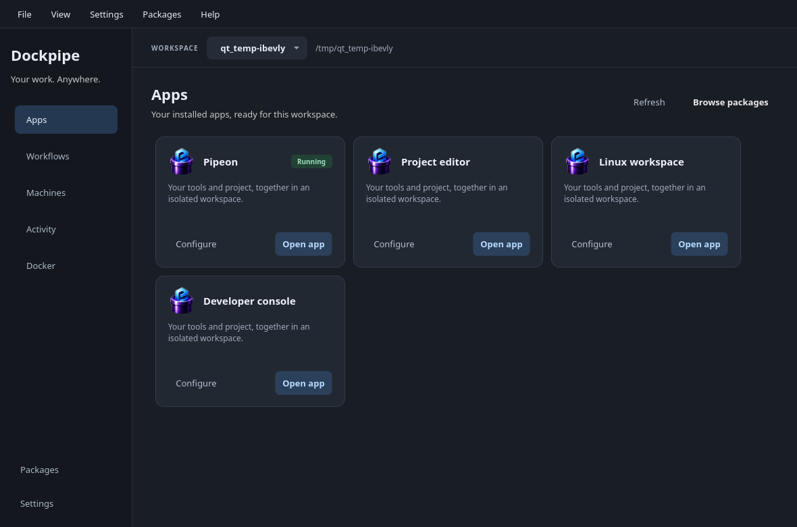
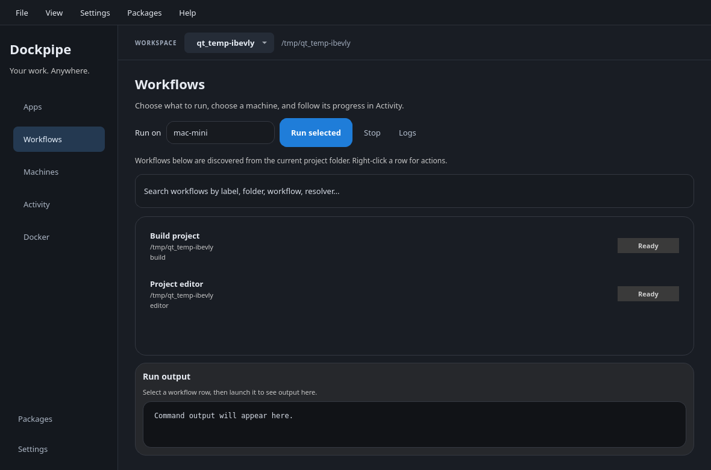

# Why we’re building Dockpipe

A useful piece of work often comes with a second, less visible job: getting everything around it to work again. Recreate the environment. Find the right command. Work out which credentials it needs. Explain the setup to the next person. Repeat the process on another machine.

That effort takes time away from the thing someone actually wanted to build.

At **Dockpipe Industries Inc.**, we’re working toward systems that make useful work easier to carry out, understand, and repeat. We want the effort spent solving a problem to remain useful when the project grows, another person joins, or the work moves somewhere else.

Dockpipe is our starting point.

*The launcher’s Apps view, captured with example workspace data. Available apps depend on the packages you install.*

Dockpipe brings commands, tools, and repeatable workflows together. You can describe how a job runs, keep that definition with your project, and package work you want to use again. The terminal and desktop launcher use the same workflow model.

Consider a project you need to return to six months from now. The build command is only part of what you need to know. Which tools does it depend on? What should run first? Where should the output go? What changes when you run it elsewhere? Making those choices explicit gives both you and the next person something to inspect, reuse, and improve.

That is the kind of friction we want to reduce.

The 0.6 release makes more of this work accessible from the desktop. You can choose a workspace, open installed apps, find workflows, and follow their output. Packages let you reuse tools and workflows across projects. Named secret environments let configuration refer to credentials held by supported providers. The CLI remains there for terminal work and CI.

*Workflow selection in the launcher, using example data. Remote workflow delivery remains a preview.*

These pieces serve the same purpose: making the setup and operation of a project easier to follow. A desktop interface helps people see what is available. A reusable package carries setup work forward. A workflow gives a repeated task a definition that can be reviewed and changed.

As automation takes on more work, understanding what it can do becomes more important. People need to decide the intent, the permissions, and the acceptable risk. They need to see what happened and have a way to intervene when something goes wrong. That principle guides how we build, including our work on AI workflows and remote execution. The protections available today depend on the selected runtime and workflow; host commands still run with that runtime’s permissions.

Our longer-term ambition at Dockpipe Industries Inc. extends to systems that help coordinate **people, machines, and resources**. Getting there requires dependable foundations: clear instructions, explicit responsibilities, visibility into execution, and useful results that can move between parts of a system.

We are beginning with software because these problems are already present in everyday development and operations. Each release is an opportunity to make those foundations more useful and learn where they still fall short.

Dockpipe 0.6 is one step in that work. It includes native distributions for Linux, macOS, and Windows, alongside a remote workflow delivery preview targeting Linux and macOS. There are unfinished areas, including macOS signing and notarization, Windows signing, and further remote and platform qualification. The release notes explain installation, upgrade considerations, and those limits.

Dockpipe is open source under Apache 2.0. You can inspect how it works, try it with your own projects, and help shape what comes next. We would like to hear where setup keeps getting repeated, where tools fail to fit together, and where automation makes work harder to understand.

Explore the project and the company at **[dockpipe.com](https://dockpipe.com)**. You can also [browse the source](https://github.com/Dockpipe-Industries/dockpipe) and [read the release notes and download Dockpipe](https://github.com/Dockpipe-Industries/dockpipe/releases/latest).
